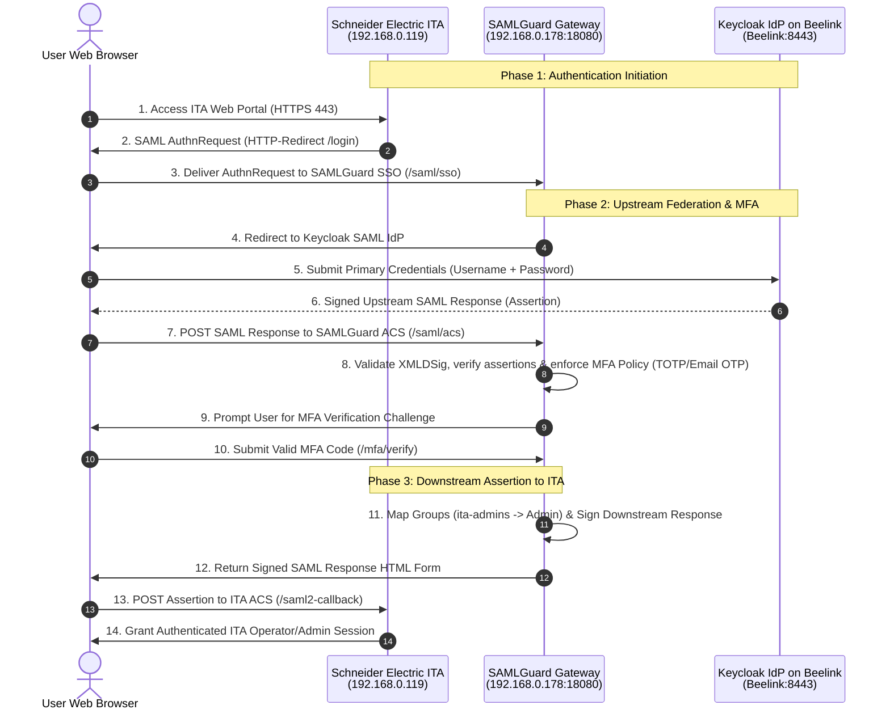

# SAMLGuard – Milestone 4, Phase 1: Environment Discovery & Staging Readiness Report

**Date:** 2026-11-10  
**Version:** v1.0.0  
**Status:** Discovery & Planning Complete  
**Recommendation:** **CONDITIONAL NO-GO (Blocker: Beelink Host Offline / IP Unassigned)**

---

## 1. Executive Summary

Milestone 4 Phase 1 establishes the baseline environmental discovery and federation deployment design across the three participating components:
1. **Schneider Electric IT Advisor (ITA):** Downstream SAML Service Provider (SP).
2. **SAMLGuard:** Intermediate Gateway (Upstream SP to Keycloak, Downstream IdP to ITA).
3. **Keycloak on Beelink:** Temporary Upstream SAML Identity Provider (IdP).

### Verdict Matrix

| Target Component | Inspection Scope | Status | Evidence & Summary |
| :--- | :--- | :---: | :--- |
| **Schneider Electric ITA** | Live HTTPS Accessibility & TLS | **PASS** | Hyper-V VM `ITA on Rocky Linux` active on `192.168.0.119`. Ports 22, 80, 443 open. HTTPS responded `HTTP 200 OK` (Apache, EcoStruxure IT UI). Certificate `CN=192.168.0.119,L=Kolding,C=DK` valid through 2038. |
| **SAMLGuard Gateway** | Configuration, Certs, Metadata | **PASS** | Binaries built (`v1.0.0`, Git `0b87eeaa`). SAML signing cert (`CN=SAMLGuard Signing`, RSA 2048) valid through 2027. Dual metadata endpoints (`/saml/metadata/sp` and `/saml/metadata/idp`) verified by independent parsers. |
| **Network & Firewall** | Ports, Inbound Filtering, SANs | **WARNING** | Windows Firewall currently has no inbound rule for SAMLGuard port 18080/8443. SAMLGuard TLS cert `cert/server.crt` lacks IP `192.168.0.178` in Subject Alternative Names (SANs). |
| **Beelink Host (Keycloak)** | OS, Docker, Hardware, Connectivity | **BLOCKED** | Host is currently not reachable on `192.168.0.0/24`. Entire subnet sweep confirmed no active host responding on Docker or SSH ports for Beelink. |

---

## 2. Infrastructure & Host Discovery

### 2.1. Schneider Electric IT Advisor (ITA)
- **Virtualization:** Microsoft Hyper-V Virtual Machine
  - **VM Name:** `ITA on Rocky Linux`
  - **VM ID:** `ba1fdc46-a5eb-4419-b1d2-00e557ef8eaa`
  - **State:** Running (CPU: ~2%, RAM Assigned: 4096 MB)
  - **Network Adapter:** Synthetic adapter bridged to `External` switch
  - **MAC Address:** `00:15:5D:12:67:1B`
- **Network Identity:**
  - **IPv4 Address:** `192.168.0.119`
  - **Active Listening Ports:**
    - `TCP 22`: Open (`SSH-2.0-OpenSSH_9.9`)
    - `TCP 80`: Open (HTTP redirect to HTTPS)
    - `TCP 443`: Open (HTTPS EcoStruxure IT Advisor web portal)
- **Web Server & Application:**
  - **Server Header:** `Apache`
  - **Application UI:** Schneider Electric EcoStruxure IT Advisor web application
  - **Status Code:** `HTTP/1.1 200 OK`
  - **Security Headers:** `Content-Security-Policy` restricting script-src to `login.ecostruxureit.com`, `X-Frame-Options: SAMEORIGIN`
- **TLS Certificate Inspection:**
  - **Subject:** `CN=192.168.0.119, L=Kolding, C=DK`
  - **Issuer:** `CN=192.168.0.119, L=Kolding, C=DK` (Self-signed by EcoStruxure IT installer in Kolding, Denmark)
  - **Validity:** `2026-07-12 08:20:28 UTC` to `2038-07-12 08:20:28 UTC` (12-year appliance validity)
  - **Key Type:** RSA 2048-bit

### 2.2. SAMLGuard Deployment Host
- **Host Hardware & OS:**
  - **Hostname:** `WMYPF4MBPEHL`
  - **OS:** Microsoft Windows 11 Enterprise (Build 26100 AMD64)
  - **Primary IP Address:** `192.168.0.178` (Interface `Qualcomm FastConnect 6900 Wi-Fi 6E`)
- **Software Build & Repository:**
  - **Version:** `v1.0.0`
  - **Git Commit:** `0b87eeaa78bf51b862c84b058c55e7ca2cc3ae97` (Branch `main`)
  - **Linux Distribution Artifacts:** `dist/samlguard-v1.0.0-linux-amd64.tar.gz` (Pure-Go CGO=0)
  - **Windows Distribution Artifacts:** `dist/samlguard-v1.0.0-windows-amd64.zip`
- **Active Configuration & Endpoints:**
  - **Config File:** `configs/config.yaml` / `configs/production.yaml`
  - **Entity ID:** `https://192.168.0.178:18080`
  - **ACS URL (Inbound from Keycloak):** `https://192.168.0.178:18080/saml/acs`
  - **SSO URL (Inbound from ITA):** `https://192.168.0.178:18080/saml/sso` (and `/login`)
  - **ITA Assertion Consumer Callback:** `https://192.168.0.119/api/current/authentication/saml2-callback`
  - **Current Runtime Status:** Stopped (Port 18080 not listening; pending Phase 2 deployment)
- **Cryptographic Assets:**
  - **TLS Certificate (`cert/server.crt`):**
    - Subject: `CN=samlguard.example.com, O=SAMLGuard, C=US`
    - SANs: DNS = `samlguard.example.com`, `localhost`; IP = `127.0.0.1`
    - Valid: `2026-07-12` to `2027-07-12`
    - *Observation:* Does not contain IP `192.168.0.178` in SANs. If strict TLS is enforced by ITA, a SAN certificate or DNS mapping is required.
  - **SAML Signing Certificate (`cert/saml-signing.crt`):**
    - Subject: `CN=SAMLGuard Signing, O=SAMLGuard, C=US`
    - Serial: `8a56df6c3c8aa02670d11af024913e38`
    - Key: RSA 2048-bit (Matches `cert/saml-signing.key` with verified SHA-256 sign/verify roundtrips)
    - Valid: `2026-07-12` to `2027-07-12`

### 2.3. Beelink Host (Target Keycloak IdP Host)
- **Status:** **OFFLINE / UNREACHABLE**
- **Discovery Evidence:**
  - Scanned full subnet `192.168.0.1` - `192.168.0.254` across ports `22`, `80`, `443`, `8080`, `8443`, `2375`, `2376`.
  - Found active IPs:
    - `192.168.0.1` (Gateway / Router)
    - `192.168.0.119` (ITA VM)
    - `192.168.0.127` (Access Point / Router)
    - `192.168.0.178` (SAMLGuard host `WMYPF4MBPEHL`)
    - IoT devices: `192.168.0.115` (Smart TV), `192.168.0.187` (Tuya IoT)
  - No host responded with Docker Engine, Docker Compose, or an available SSH management shell for Beelink.
- **Action Required from Operator:**
  1. Verify physical power to the Beelink mini-PC.
  2. Confirm network cable connection or Wi-Fi association on the `192.168.0.0/24` subnet.
  3. Provide assigned IP address and SSH credentials for Phase 2 container provisioning.

---

## 3. Network Topology & Federation Flow



---

## 4. Federation Metadata Verification

The two independent metadata endpoints implemented in Milestone 3.1 were validated against SAML 2.0 specifications and independent parsers:

### 4.1. Upstream SP Metadata (`GET /saml/metadata/sp`)
- **Target Audience:** Keycloak / Microsoft Entra ID
- **Entity ID:** `https://192.168.0.178:18080`
- **Descriptor Type:** `<md:SPSSODescriptor>`
- **AssertionConsumerService:**
  - Binding: `urn:oasis:names:tc:SAML:2.0:bindings:HTTP-POST`
  - Location: `https://192.168.0.178:18080/saml/acs`
  - Index: `0` (isDefault: `true`)
- **KeyDescriptor:** Signing X.509 Certificate included (Base64 encoded)
- **Role Isolation:** Zero `<md:IDPSSODescriptor>` elements (prevents upstream parser ambiguity)

### 4.2. Downstream IdP Metadata (`GET /saml/metadata/idp`)
- **Target Audience:** Schneider Electric IT Advisor (External IdP Configuration)
- **Entity ID:** `https://192.168.0.178:18080`
- **Descriptor Type:** `<md:IDPSSODescriptor>`
- **SingleSignOnService:**
  - Binding 1: `urn:oasis:names:tc:SAML:2.0:bindings:HTTP-Redirect` (`https://192.168.0.178:18080/saml/sso`)
  - Binding 2: `urn:oasis:names:tc:SAML:2.0:bindings:HTTP-POST` (`https://192.168.0.178:18080/saml/sso`)
- **KeyDescriptor:** Signing X.509 Certificate included
- **Role Isolation:** Zero `<md:SPSSODescriptor>` elements (matches ITA expectation for external IdP)

---

## 5. Keycloak Deployment Design for Beelink

A standalone containerized architecture has been authored in `deployments/keycloak/docker-compose.yml`:

### Architecture Components
1. **Container Engine:** Docker Compose v2 with pure bridge isolation.
2. **Keycloak Version:** `quay.io/keycloak/keycloak:25.0.2` (Quarkus-based, official release).
3. **Database Backend:** Dedicated PostgreSQL 16 (`postgres:16-alpine`) with healthcheck barrier.
4. **Secret Storage:** Docker Swarm/Compose file secrets (`./secrets/db_password.txt`, `./secrets/admin_password.txt`) avoiding cleartext environment variables.
5. **TLS Strategy:** Mounted certificates in `/opt/keycloak/conf/` for native Quarkus HTTPS on port 8443.

### SAML Realm & Client Plan
- **Realm Name:** `samlguard-realm`
- **SAML Client ID:** `https://192.168.0.178:18080`
- **SAML Client Settings:**
  - Master SAML Processing URL: `https://192.168.0.178:18080/saml/acs`
  - Sign Documents: `ON`
  - Sign Assertions: `ON`
  - Signature Algorithm: `RSA_SHA256`
  - NameID Format: `email` (or `persistent`)
  - Attribute Mappers:
    - `email` -> `email` (AttributeFormat: Basic)
    - `groups` -> `groups` (Multi-valued attribute mapper)
- **Test User Provisioning:**
  - User: `ita-admin` | Email: `ita-admin@example.local` | Group: `/ita-admins`
  - User: `ita-operator` | Email: `ita-operator@example.local` | Group: `/ita-operators`

---

## 6. Firewall & DNS Checklist

| Source | Destination | Protocol / Port | Purpose | Current Status | Required Action |
| :--- | :--- | :--- | :--- | :---: | :--- |
| User Browser | SAMLGuard (`192.168.0.178`) | TCP `18080` | Inbound SSO & MFA Web UI | **BLOCKED** | Add Windows Firewall rule on `WMYPF4MBPEHL` allowing inbound TCP 18080. |
| User Browser | ITA (`192.168.0.119`) | TCP `443` | ITA Web Portal access | **OPEN** | Verified live (`200 OK`). |
| User Browser | Keycloak (Beelink) | TCP `8443` | Upstream IdP Login form | **PENDING** | Open TCP 8443 on Beelink host firewall upon startup. |
| ITA VM (`192.168.0.119`) | SAMLGuard (`192.168.0.178`) | TCP `18080` | Fetch SAMLGuard IdP Metadata | **BLOCKED** | Windows Firewall rule required on SAMLGuard host. |
| SAMLGuard (`192.168.0.178`) | ITA VM (`192.168.0.119`) | TCP `443` | Outbound ACS / TLS Handshake | **OPEN** | Verified live via TCP connect and HTTP probe. |
| SAMLGuard (`192.168.0.178`) | Keycloak (Beelink) | TCP `8443` | Fetch Keycloak SP Metadata | **PENDING** | Verify route once Beelink IP is online. |

---

## 7. Deployment Runbook (Phase 2 Preview)

### Step 1: Power On & Discover Beelink Host
```bash
# Verify IP address assigned to Beelink on local network
ping <BEELINK_IP>
ssh <user>@<BEELINK_IP> "docker --version && docker compose version"
```

### Step 2: Deploy Keycloak Stack
```bash
# Transfer deployments/keycloak to Beelink host
scp -r deployments/keycloak user@<BEELINK_IP>:~/keycloak-stack
ssh user@<BEELINK_IP>
cd ~/keycloak-stack

# Initialize secure random passwords
mkdir -p secrets
openssl rand -base64 24 > secrets/db_password.txt
openssl rand -base64 24 > secrets/admin_password.txt
chmod 600 secrets/*

# Start containers
docker compose up -d
docker compose ps
```

### Step 3: Configure SAMLGuard Inbound Firewall
```powershell
# On Windows host (WMYPF4MBPEHL) as Administrator:
New-NetFirewallRule -DisplayName "SAMLGuard Gateway Inbound" `
    -Direction Inbound `
    -Protocol TCP `
    -LocalPort 18080,8443 `
    -Action Allow
```

### Step 4: Launch SAMLGuard Gateway
```powershell
# Start SAMLGuard on host
.\bin\samlguard.exe -config .\configs\config.yaml
```

### Step 5: Test End-to-End Federation Flow
1. Open browser in incognito mode to `https://192.168.0.119`.
2. Click **Log In with External SAML IdP**.
3. Verify redirect to SAMLGuard SSO (`https://192.168.0.178:18080/saml/sso`).
4. Verify forward to Keycloak Login (`https://<BEELINK_IP>:8443`).
5. Authenticate as `ita-admin`.
6. Complete SAMLGuard TOTP challenge.
7. Confirm successful return and login to IT Advisor dashboard.

---

## 8. Outstanding Blockers & Decision Points

1. **[BLOCKER 1 - Physical Infrastructure] Beelink Mini-PC Offline:**  
   The Beelink host is not currently powered on or connected to the subnet `192.168.0.0/24`. Phase 2 container provisioning cannot begin until the operator connects Beelink to power and the LAN and supplies its IP address and SSH credentials.

2. **[DECISION 1 - TLS Trust Strategy] IP vs Hostname & Certificate SANs:**  
   SAMLGuard's `cert/server.crt` currently has SANs `samlguard.example.com` and `127.0.0.1`, but does NOT have `192.168.0.178`.  
   *Options:*
   - *Option A (Recommended for Staging):* Map hostname `samlguard.local` in `C:\Windows\System32\drivers\etc\hosts` and on Beelink/ITA `/etc/hosts`, and add `samlguard.local` to certificate SANs.
   - *Option B:* Regenerate TLS certificate to explicitly include IP `192.168.0.178` in the `IPAddresses` SAN extension.

3. **[DECISION 2 - ITA SAML Configuration Mode]:**  
   Confirm whether ITA will import SAMLGuard IdP metadata dynamically via URL (`https://192.168.0.178:18080/saml/metadata/idp`) or via manual XML upload. Both are supported.

---

## 9. Final Phase 2 Recommendation

### **Recommendation: CONDITIONAL NO-GO**
- **Technical Status:** SAMLGuard software, cryptographic keys, metadata isolation, and ITA target server accessibility have fully **PASSED** automated and live validation.
- **Single Gating Blocker:** The Beelink host is currently offline and unreachable on the network. Once the operator powers on Beelink and confirms its network IP, Milestone 4 Phase 2 (Keycloak Provisioning & Live Federation Testing) can proceed immediately.

